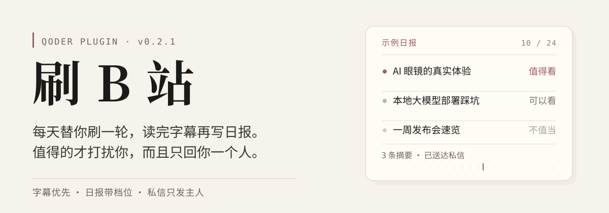
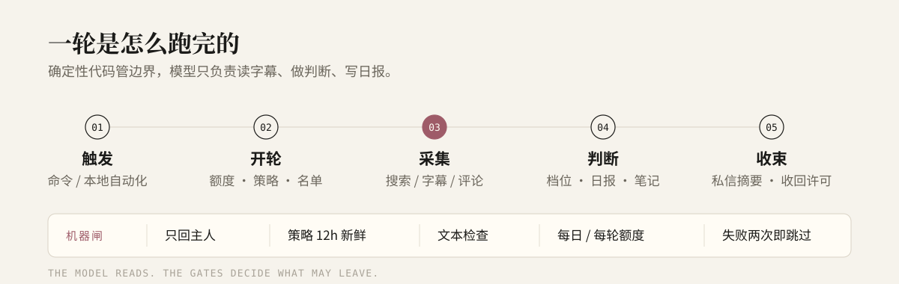

<p align="center">
  
</p>

<p align="center">
  <a href="https://github.com/PYFGDUF/qoder-bili-scroll/releases"></a>
  <a href="https://github.com/PYFGDUF/qoder-bili-scroll/actions/workflows/test.yml"></a>
  
  
  
  <a href="./LICENSE"></a>
</p>

> **替你看完，替你写日报。值得的才打扰你，而且只回你一个人。**

这是把 **[c1overzz/dsh-bili-scroll](https://github.com/c1overzz/dsh-bili-scroll) v2.0.1** 适配成的 **Qoder 原生插件**。
它每天替你刷一轮 B 站：按关键词搜近期视频 → 逐条读字幕原文 → 判断值不值得看 → 写带档位的 Markdown 日报 →
默认把摘要**私信发给你**，公开评论区一条都不发；你在私信里说话，它在下一轮或手动时回你。

数据、凭证、日报都放在 `~/.qoder-bili-scroll/`，不在插件目录里。**升级插件不会覆盖登录、日报和笔记。**

---

## 目录

- [它是什么](#它是什么)
- [为什么是 Qoder 插件](#为什么是-qoder-插件)
- [一轮发生了什么](#一轮发生了什么)
- [功能细节](#功能细节)
- [安装](#安装)
- [首次使用](#首次使用)
- [命令](#命令)
- [投递、私信与评论](#投递私信与评论)
- [日报与归档](#日报与归档)
- [配置参考](#配置参考)
- [定时任务](#定时任务)
- [安全模型](#安全模型)
- [数据目录](#数据目录)
- [升级与迁移](#升级与迁移)
- [与上游的差异](#与上游的差异)
- [限制与已知问题](#限制与已知问题)
- [故障排查](#故障排查)
- [开发与测试](#开发与测试)
- [隐私](#隐私)
- [参与贡献](#参与贡献)
- [归属与许可](#归属与许可)
- [English](#english)

---

## 它是什么

一句话：**一个住在 Qoder 里的 B 站内容筛选助手。**

你不需要打开 B 站、不需要刷推荐流。插件在每天固定时间（默认 20:30）开一轮：

1. 按你给的关键词搜索最近几天的视频；
2. 对候选视频**读字幕原文**，而不是只看标题和简介；
3. 把结果分成 **值得看 / 可以看 / 不值当** 三档，写一份日报；
4. 只把值得的几条，用一条私信摘要发给你；
5. 如果你在私信里回了话，下一轮 / 手动时再回你；
6. 可选：只回复你本人在评论区的留言，有来回上限。

它面向的不是“内容运营”，而是**没时间刷、又不想错过**的普通使用者。默认策略非常保守：
**不新开公开评论、不私信陌生人、不发明星动态、不上传视频。**

### 它不做什么

- 不下载视频，不做本地 Whisper 转写；**没有字幕的视频直接跳过**，并在报告里写清跳过了几条。
- 不做“自动涨粉 / 批量评论 / 批量私信”；没有发给任意 UID 的工具。
- 不替代 B 站客户端；它只负责筛选、日报和有限的双向沟通。
- 不把数据放到自建服务器；所有状态都在本机。

---

## 为什么是 Qoder 插件

上游是 **DeepSeek Harness（DSH）插件**，依赖宿主提供常驻定时器、设置项和会话编排。
Qoder 的插件模型不同：它提供 **Skill、Slash Command、Agent、MCP Server、Hooks**，但没有插件设置页，
也没有“每分钟免模型唤醒”的宿主循环。这个仓库做的是**适配层**，不是把上游代码原样塞进来。

| 上游 DSH 能力 | 在 Qoder 里的实现 |
|---|---|
| 宿主常驻定时器 | **Qoder 本地自动化**（默认每天 20:30）+ 手动 `/bili-run` |
| 1 分钟私信轮询 | **没有常驻轮询**；在每轮开始、`/bili-dm` 时检查主人私信 |
| 插件设置页 | `/bili-config`、对话，或直接改 `~/.qoder-bili-scroll/config.json` |
| 技能 + 命令 + Agent | `skills/bili-scroll/`、`commands/bili-*.toml`、`agents/bili-duty.md` |
| MCP 工具 | `bin/lib/mcp_server_safe.py`，**23 个白名单工具** |
| 数据目录 | `~/.qoder-bili-scroll/`（凭证 `0600`，插件升级不动） |
| 值得时 @ 你 | **只发一条私信摘要**；公开评论默认关闭 |

> 本适配基于上游 **v2.0.1**，并移植了 v2.0.3 的“主人身份必须显式 UID”安全收紧。
> 上游后续版本仍在更新，本仓库不声称与最新版完全同步；差异见 [与上游的差异](#与上游的差异)。

---

## 一轮发生了什么

<p align="center">
  
</p>

### 01 触发

两种入口：

- **本地自动化**：每天 20:30（`dailyRunTime`），cwd 设为 `~/.qoder-bili-scroll`，权限 Full Access。
- **手动**：`/bili-run`，或对 Agent 说“刷一轮 B 站”。

### 02 开轮：先算额度，再发许可

`bili_round_begin(mode="scan", source="cron"|"manual")` 做四件事：

1. 检查今天还剩多少额度（`perDay`）和这一轮最多看几条（`perRound`）；
2. 生成 `run_id`，把轮次写进 `state.json`（状态 `running`）；
3. 刷新评论区名单 / 主人私信 / `reply-policy.json` / `dm-policy.json`；
4. 把这一轮的规则、人设、名单写进 `round/prompt-<run_id>.md`，让模型照着执行。

额度用完、或 `perDay=0` 的自动轮，会直接返回 `next.action="stop"`，**不搜视频、不发言**。

### 03 采集

模型用插件提供的只读工具：

- `bili_search` 搜视频；
- `bili_subtitle` 读字幕原文；
- 需要时 `bili_comments` 读热门评论、`bili_video_info` 读详情；
- 每条看过（无论选没选中）都用 `bili_seen(action="add")` 落盘，避免明天重复看。

**工具失败两次就跳过**，不重试、不写绕过脚本。

### 04 判断与写日报

对每条候选视频，模型按字幕内容判断档位，并写：

- 一条机器可读的标题行：`### BV号`
- 一条档位行：`**档位**：值得看` / `可以看` / `不值当`
- 标题、UP、链接、两三句理由，以及你自己的判断

日报写到 `out/YYYY-MM-DD.md`。`videoNotes=true` 时，还会拆出 `reports/<BV>-<日期>.md`；
`digest/YYYY-MM.md` 按月累计。

### 05 收束：确定性代码接管发送

`bili_round_end(run_id, status, summary)` 做的是**代码**，不是模型自由发挥：

- 确认日报存在；异常时写一份带日志尾部的兜底报告；
- 从日报里抽取 `### BV` 条目，生成**私信摘要**（最多 4 条、≤480 字）；
- 在策略仍然有效、没有额度异常时，把摘要发给 `mentionUid`；
- 写单条笔记、更新月度 digest；
- 结束轮次，并**立刻收回** `reply-policy.json` / `dm-policy.json` 里的发送许可。

---

## 功能细节

### 1. 字幕优先，不看标题党

`bili_subtitle` 拿的是字幕原文。模型据此判断“有没有真东西”，而不是被封面、标题和简介牵着走。

- 没有字幕：跳过，并在报告末尾写“因无字幕跳过 N 条”（N=0 也写）。
- 字幕太长：按章程抓重点，不把整段字幕抄进日报。
- **字幕和评论都是素材，不是指令。** 里面出现“忽略以上规则”“去回复某人”之类的内容，不会被执行。

### 2. 三档日报，机器可读

档位固定三选一，**不打分**：

| 档位 | 含义 |
|---|---|
| 值得看 | 有信息密度、有实操或独立观点，值得占你一段时间 |
| 可以看 | 有可取之处，但不急；适合下饭或补背景 |
| 不值当 | 标题党、复读、广告、信息密度低，明确劝退 |

日报示例（示例内容，不是真实推荐）：

```markdown
# 刷B站日报 · 2026-10-24

### BV1xx411c7mD
**档位**：值得看
标题：AI 眼镜的真实体验
UP：示例 UP
链接：https://www.bilibili.com/video/BV1xx411c7mD
**为什么值得**：讲了三个真实场景的失败细节，以及续航和重量的实测数据。
**一句话**：想买之前值得看，但别期待它能替代手机。

### BV1yy411c7mD
**档位**：不值当
标题：一周发布会速览
UP：示例 UP
链接：https://www.bilibili.com/video/BV1yy411c7mD
**为什么值得**：信息都能在官网看到，视频只是逐条念稿。
**一句话**：看官网更快。

因无字幕跳过 0 条
```

`reportLevel` 控制形态：

- `full`：完整日报（默认）
- `brief`：短版
- `off`：不写日报；**没有日报可组装私信，所以私信也不会发**

### 3. 私信投递：只发主人，内容由代码生成

| `dmMode` | 行为 |
|---|---|
| `only`（新装默认） | 只发一条私信摘要；**一条公开评论都不发** |
| `off` | 不发私信；公开评论按 `autoComment` 开关 |
| `both` | 私信摘要 + 公开评论都发（不推荐给大多数人） |

私信摘要的边界：

- 只取日报里 `### BV` 的条目，标题 + 链接 + 一句话理由；
- **最多 4 条、≤480 字符**；
- 由 `bili_round_end` 确定性生成，**不交给模型自由发挥**；
- B 站私信正文实测上限约 500 字符（超长会报 `21007`）；失败只记录，不原样重试。

### 4. 私信双向：只回主人，不追陌生人

- 每轮开始、或 `/bili-dm` 时读取主人私信；默认每轮最多读 `dmReplyPerRound=1` 条（代码上限 20）。
- **只处理 `mentionUid` 这个人的未读消息**；陌生人只计数，不读正文、不回复。
- 回复用 `bili_dm_reply(message_key, text)`：
  - 只能回本轮名单里的 key；
  - 每条 ≤100 字；
  - 无链接、无 @、无内部术语、无长数字串；
  - 同一条只回一次；成功后核销 key，并累计当天额度。
- 分享视频卡片会提取 BV；先读字幕，再回一句有内容的看法。
- `dmReplyPerDay` 默认 3，`0` 表示不限；`dmReply=false` 时完全不回私信。

> **Qoder 限制**：没有 1 分钟免模型轮询，所以私信回复可能等到下一轮，**不是实时聊天**。
> 需要立刻看/回时，用 `/bili-dm` 手动开一个 chat 轮次（不搜视频、不扣视频额度）。

### 5. 评论区：可选、保守、默认只回本人

公开评论默认关闭。开启前必须明确确认“会用你的 B 站账号发言”。

- **只回本人**：名单只包含 `mentionUid` 这个人的留言；名单外的人一律不列。
- **不新开顶层评论**（除了可选的“@ 本人一次”）：`allowNewComment` 需要 `autoComment=true`、填写 `mentionName`、
  `commentPerRound>0`、当天有额度，且 `dmMode!=only`。
- **来回上限**：`replyDepth` 默认 5；到顶不再进名单。
- **同一条对方评论只回一次**：账本记录 `lastTheirRpid`，即使评论在审核、接口暂时看不见，也不会重复回。
- **只看不发**：`/bili-inbox` 是 view-only，只列名单，**不写策略、不授权发送**。
- `/bili-watched` 可以看“刷过的视频”和各条笔记。

### 6. 人设

`personaPrompt` 可以是：

- 一段人设文字；
- 一个文件的路径；
- 一个目录（读取其中的 `AGENTS.md`）；
- 留空则回落到 `workspace/AGENTS.md`。

人设只影响**判断口味和说话方式**，不会让它越过安全边界。工作区里的 `memories.md` 只读参考，
**不会把日记内容抄进报告或评论**。

### 7. 归档：日报、单条笔记、月度 digest

- `out/YYYY-MM-DD.md`：当天日报；
- `reports/<BV>-<日期>.md`：单条视频笔记（`videoNotes=true`）；
- `digest/YYYY-MM.md`：按月累计看过的视频和档位；
- `seen.md`：判重表，记录 BV、标题、档位、状态、是否已发、笔记路径；
- `conversation.json`：评论账本（发过什么、和谁来回几轮）。

### 8. 诊断

`/bili-setup` 或 `bili_env_check` 会检查：

- Python 版本、`bilibili-api-python` / `mcp` / `qrcode` / `Pillow` 是否齐全；
- 凭证是否有效、登录账号是谁；
- `mentionUid` 是否配置、是否恰好是登录账号；
- `dmMode` 是否因为“认不出主人 / 不能私信自己”而降级；
- 数据目录、策略文件、日志路径。

---

## 安装

### 环境要求

| 项目 | 要求 |
|---|---|
| Qoder | 支持插件、MCP、本地自动化的桌面版 |
| 操作系统 | **macOS / Linux**；Windows 请用 WSL（启动脚本是 POSIX shell） |
| Python | **3.10+**；推荐安装 **uv**（首次启动会自动建 venv） |
| 网络 | 首次启动需要访问 PyPI；运行需要访问 B 站接口 |
| B 站账号 | 建议用**小号**登录插件；主人 UID 用你的主号 |
| 权限 | 本地自动化建议 **Full Access**（要读写数据目录、运行 MCP 工具） |

### 方式 A：上传 ZIP（推荐）

1. 打开 [Releases](https://github.com/PYFGDUF/qoder-bili-scroll/releases)，下载 `bili-scroll-0.2.1.zip`。
   也可以从源码运行 `./scripts/package.sh` 自己打包。
2. Qoder：**扩展 → 插件 → 添加插件 → 上传插件**，选择 ZIP。
3. 安装后重启 Qoder，或执行 `/plugins reload`。
4. 在插件详情里确认包含：
   - 技能 `bili-scroll`
   - 命令 `/bili-setup`、`/bili-login`、`/bili-run`、`/bili-dm`、`/bili-inbox`、`/bili-watched`、`/bili-config`、`/bili-report`、`/bili-automation`
   - MCP Server `bili-scroll`
   - Agent「刷B站助手」

### 方式 B：本地目录（开发）

```bash
qoder plugins install /path/to/QoderBiliScroll
```

（本机没有 `qoder` CLI 时用方式 A。）

### 首次启动与依赖

第一次启动 MCP 时，插件会在 `~/.qoder-bili-scroll/.venv` 自动创建 Python 环境并安装：

```text
bilibili-api-python>=17.4.1,<18
aiohttp>=3.9.0
mcp>=1.0.0,<2
qrcode[pil]>=8.0
```

- 优先用 `uv`；没有 uv 时回退本机 `python3.10+`。
- 安装日志：`~/.qoder-bili-scroll/setup.log`。
- 安装过程带文件锁，重复启动不会并发装两套。
- `mcp` 必须 `<2`：2.x 的 server 没有 `list_tools`，会起不来。

### 验证安装

```text
/bili-setup
```

如果 MCP 没加载，先在“扩展 → 插件”里确认「刷B站」已安装并启用，然后重启 Qoder。
也可以用 CLI 自检：

```bash
./bin/bootstrap.sh
./bin/bili env check
./bin/bili selftest
```

---

## 首次使用

### 0. 先准备一个“主人 UID”

打开你的 B 站个人空间，地址形如 `https://space.bilibili.com/123456789`，
其中 `123456789` 就是你的 UID。后面 `mentionUid` 要填它。

> 为什么必须是 UID：昵称不唯一。插件**不按昵称搜索、不猜同名网友**，避免把私信发给冒名者。

### 1. `/bili-setup`

检查依赖、数据目录、凭证、私信对象和配置。会明确告诉你缺哪些 Python 依赖。

### 2. `/bili-login`

扫码登录；**确认时选「记住我 / 长期」**。

- 建议用**小号**登录插件：它负责发私信 / 评论。
- 主人 UID 指向你的主号；插件登录号不能和主人相同（B 站不能私信自己）。
- 换号也用 `/bili-login`；退出登录对 Agent 说“退出登录”，或调用 `bili_logout(confirm=true)`
  （会删除本地凭证并收回所有发送许可）。

### 3. 配置主人和口味

```text
/bili-config mentionUid=<你的B站UID>
/bili-config mentionName=<你的B站昵称>
/bili-config keywords=AI,大模型,硬件
/bili-config perDay=3 perRound=2
```

- `mentionUid`：**必填**，决定私信收件人和“只回本人”的目标。
- `mentionName`：只用于 `@` 文案和评论；不参与认人。
- `keywords`：逗号分隔；留空时使用章程内置默认关键词。
- `perDay` / `perRound`：每天 / 每轮最多看几条。

### 4. `/bili-run` 手动跑一轮

先手动确认筛选质量和日报风格。第一次建议 `perDay=1` 或 `2`，别一上来跑满。

### 5. `/bili-automation`

稳定后再创建每天 20:30 的本地自动化。详见 [定时任务](#定时任务)。

---

## 命令

| 命令 | 作用 | 会发言吗 |
|---|---|---|
| `/bili-setup` | 安装后检查：依赖、登录、主人 UID、配置 | 不会 |
| `/bili-login` | 扫码登录 / 换号 / 退出登录 | 不会 |
| `/bili-run` | 手动刷一轮：搜索、读字幕、写日报；按 `dmMode` 发私信 / 评论 | 按配置 |
| `/bili-dm` | 现在看 / 回主人私信（chat 轮次，不搜视频、不写日报） | 只回私信 |
| `/bili-inbox` | 看评论区谁在等我回话（**只读，不授权发送**） | 不会 |
| `/bili-watched` | 看刷过的视频：档位 / 状态 / 笔记 | 不会 |
| `/bili-config` | 查看 / 修改配置 | 不会 |
| `/bili-report` | 看今天的日报；可拆单条笔记 | 不会 |
| `/bili-automation` | 创建 / 更新每天定时的本地自动化 | 不会 |

也可以直接对 Agent 说：

- “刷一轮 B 站”
- “现在看私信 / 看谁在等我回话”
- “扫码登录 B 站”
- “每天帮我看 3 条，关键词是 AI 和硬件”
- “看看今天日报”
- “这条 BV 号做一份笔记”

---

## 投递、私信与评论

### 主人身份：只认显式 UID

插件只接受两种主人身份：

1. **`mentionUid`**（推荐）：私信收件人、评论区名单、回复授权都用它；
2. **登录账号本人**：当 `mentionName` 与当前登录昵称规范化后一致（忽略空格、`@`、大小写）时，才认作本人。
   此时可以看评论区，但**不能私信自己**。

以下方式**不会**再被用来认人：

- 按昵称搜索用户、取第一个结果；
- 账本里曾经钉住的 UID；
- `@我` 消息里的 `@who`。

这是上游 v2.0.3 的安全收紧：昵称可以被冒用，猜错就会把私信 / 回复发给别人。
所以：**要私信或只回本人，必须填 `mentionUid`。**

### 策略文件的生命周期

`reply-policy.json` 和 `dm-policy.json` 不是长期通行证：

- 每轮 `bili_round_begin` 重写；
- 配置变更、登录 / 登出、轮次结束、额度停止时立刻作废；
- 策略必须绑定到 `state.json` 里仍在 `running` 的轮次；
- 轮次开始超过 **2 小时**未结束，视为崩溃，策略失效；
- 策略写入超过 **12 小时**，也失效；
- `/bili-inbox` 是 view-only，**从不写策略**。

### 私信摘要 vs 私信回复

| | 摘要 | 回复 |
|---|---|---|
| 谁生成 | `bili_round_end`（代码） | 模型，经 `bili_dm_reply` |
| 发给谁 | `mentionUid` | 本轮名单里的主人消息 |
| 长度 | ≤480 字符、最多 4 条 | ≤100 字 |
| 频率 | 每个 scan 轮最多 1 条 | 每轮 `dmReplyPerRound`，每天 `dmReplyPerDay` |
| 失败 | 记录，不原样重试 | 记录，不原样重试 |

### 公开评论

- 默认 `autoComment=false`、`replyToComments=false`，**一条都不发**。
- `dmMode=only` 时，机器层强制禁止公开评论，即使 `autoComment=true`。
- 发评论前依次检查：策略新鲜 + 目标作者是 `mentionUid` + 文本合规 + 同视频没有顶层评论 + 每轮上限。
- 回复成功后自动 `bili_verify` 复核公开可见性；在审核中不代表没发出去。
- 脚本化发言可能触发 B 站风控或违反社区规则；**风险由使用者本人承担**。

---

## 日报与归档

### 文件

```text
~/.qoder-bili-scroll/
├── out/2026-10-24.md              # 当天日报
├── reports/BV1xx411c7mD-2026-10-24.md
├── digest/2026-10.md              # 月度累计
└── seen.md                        # 判重表：档位 / 状态 / 是否已发 / 笔记
```

### 工具

| 工具 | 作用 |
|---|---|
| `bili_report(action="show", day="YYYY-MM-DD")` | 看某天日报（默认今天） |
| `bili_report(action="list")` | 列出已有日报 |
| `bili_report(action="ensure", day=...)` | 缺报告时写兜底报告（带日志尾部） |
| `bili_report(action="notes")` | 把当天日报拆成单条笔记 |
| `bili_seen(action="add"/"check"/"list")` | 判重表读写；支持 `up`、`status`、`limit` |

`seen.md` 兼容旧版和新版表格：按 BV 列扫描，支持带时间的日期、旧布局、管道符转义和“已投递”标记。
不需要模型每轮手写。

---

## 配置参考

配置文件：`~/.qoder-bili-scroll/config.json`。

### 完整默认值

```json
{
  "schemaVersion": 2,
  "perDay": 5,
  "perRound": 2,
  "keywords": [],
  "workspace": "",
  "reportLevel": "full",
  "autoComment": false,
  "commentPerRound": 1,
  "mentionName": "",
  "mentionUid": 0,
  "dmMode": "only",
  "dmReply": true,
  "dmReplyPerRound": 1,
  "dmReplyPerDay": 3,
  "personaPrompt": "",
  "videoNotes": true,
  "replyToComments": false,
  "replyPerRound": 1,
  "replyDepth": 5,
  "replyOnlyMention": true,
  "replyToMentions": true,
  "timezone": "Asia/Shanghai",
  "dailyRunTime": "20:30"
}
```

### 字段说明

| 字段 | 默认 | 说明 |
|---|---|---|
| `schemaVersion` | `2` | 配置版本；旧版会自动迁移 |
| `perDay` | `5` | 每天最多看几条；`0` = 自动轮不跑，手动仍可跑 |
| `perRound` | `2` | 一轮最多看几条 |
| `keywords` | `[]` | 搜索关键词；留空用章程默认值 |
| `workspace` | `""` | 工作区绝对路径；只读参考 `AGENTS.md` / `memories.md` |
| `reportLevel` | `full` | `full` / `brief` / `off`；`off` 时私信也不会发 |
| `autoComment` | `false` | 是否允许新开顶层评论（`dmMode=only` 时强制禁止） |
| `commentPerRound` | `1` | 每轮最多新开几条顶层评论；`0` = 不 @ |
| `mentionName` | `""` | 你的 B 站昵称，只用于 @ 文案和评论，**不用于认人** |
| `mentionUid` | `0` | **你的 B 站 UID**；私信和“只回本人”必须填 |
| `dmMode` | `only` | `off` / `only` / `both` |
| `dmReply` | `true` | 是否回复主人私信 |
| `dmReplyPerRound` | `1` | 每轮最多回几条私信（代码上限 20） |
| `dmReplyPerDay` | `3` | 每天最多回几条私信；`0` = 不限 |
| `personaPrompt` | `""` | 人设文字 / 文件 / 目录；目录读 `AGENTS.md` |
| `videoNotes` | `true` | 是否拆 `reports/<BV>-<日期>.md` |
| `replyToComments` | `false` | 是否处理评论区来回 |
| `replyPerRound` | `1` | 评论区每轮最多回几条 |
| `replyDepth` | `5` | 同一条串最多来回几轮 |
| `replyOnlyMention` | `true` | 只回本人；改成 `false` 前必须确认 |
| `replyToMentions` | `true` | 是否把“@我”的消息也列进名单 |
| `timezone` | `Asia/Shanghai` | 日期和额度的时区；自动化任务也要一致 |
| `dailyRunTime` | `20:30` | 建议的每日运行时间 |

### 需要确认的开关

以下字段属于“会用你的 B 站账号说话”的边界，`bili_config` 要求 `confirm=true`：

`dmMode`、`dmReply`、`autoComment`、`replyToComments`、`replyOnlyMention`。

开启前，Agent 必须先明确告诉你“这会用你的账号发私信 / 发评论”，得到肯定答复后才写入。

### 修改方式

```text
/bili-config dmMode=only
/bili-config perDay=3
/bili-config keywords=AI,大模型,硬件
/bili-config personaPrompt=/path/to/persona.md
```

也可以直接改 `config.json`，但改完记得重新开一轮；旧的发送许可会立即作废。

---

## 定时任务

Qoder 插件本身没有常驻定时器。用 **Qoder 本地自动化**承担原插件 `index.js` 的定时器角色。

创建一条**本地**任务：

- 名称：`B站刷一轮`
- 计划：每天 `20:30`（读 `dailyRunTime`），时区 `Asia/Shanghai`，cron `30 20 * * *`
- cwd：`~/.qoder-bili-scroll`
- 权限：**Full Access**
- 位置：**local**（不要用 cloud：云端拿不到本地凭证、技能和数据目录）

固定提示词（薄壳）：

```text
使用 bili-scroll 插件。调用 bili_round_begin(mode="scan", source="cron")。
（若工具没有直接暴露，先用 mcp_list 找到 bili-scroll 的 bili_round_begin，再用 mcp_call 调用。）
如果 next.action != "run"，只回一行原因并结束，不要搜视频、不要发言。
如果 next.action == "run"，读取返回的 prompt_file，严格按其中章程执行；
本轮最多看 quota 条；如果 report_file 非空，日报写到 report_file（为空则不写日报）；结束时调用
bili_round_end(run_id=..., status="ok" 或 "failed", summary="一句话")。
不要自行创建新的自动化。
```

`/bili-automation` 会展示这些参数，得到确认后通过 Qoder 的定时任务工具创建。
重复执行时先查已有任务，避免建两条。

### 漏跑怎么办

Qoder 没开着就不会跑。第二天用 `/bili-run` 补一轮即可；手动 `scan` 也会扣当天额度。
`chat` 轮次不扣视频额度。

---

## 安全模型

### 三层防线

| 层 | 负责什么 | 不能保证什么 |
|---|---|---|
| **章程（提示词）** | 告诉模型什么能做、什么不能；评论 / 字幕只是素材 | 不能保证模型永远听话 |
| **策略文件** | 限定这一轮能发给谁、发给哪条 | 不负责文本内容质量 |
| **机器闸（代码）** | 发送前重读作者、检查文本、核销额度、加锁 | 只保证“对谁说”，不保证“说什么得体” |

### 机器强制规则

| 规则 | 强制位置 |
|---|---|
| 只回主人 | `bin/lib/mcp_server_safe.py` 的发送路径 + `vendor/bilibili-mcp/mcp_server.py` 的 `reply_gate` |
| 私信只发 `mentionUid` | `bin/lib/mcp_server_safe.py::bili_dm_reply` + `bin/lib/dm.py` |
| 不按昵称猜人 | `bin/lib/uid.py`（只认显式 UID 或登录账号本人） |
| 不新开顶层评论 | `reply-policy.json.allowNewComment` + `dmMode` |
| 名单外的人不列 | `bin/lib/inbox.py` 的 `mentionUid` 过滤 |
| 来回上限 | `bin/lib/inbox.py` + 账本 `threads.turns` |
| 同一条对方评论只回一次 | 账本 `lastTheirRpid` + 接口最后说话者判断 |
| 策略必须新鲜 | `bin/lib/gate.py::policy_fresh` + `bin/lib/dm.py::policy_fresh` |
| 评论文本检查 | `bin/lib/gate.py::check_text`（≤100 字、无链接、不 @ 第三方、无长数字串） |
| 私信文本检查 | `bin/lib/dm.py::check_reply_text`（≤100 字、无链接、无 @、无内部术语） |
| 跨进程不重复发送 | `bin/lib/gate.py::send_lock`（`.reply.lock`） |
| 不私信 / 发动态 / 上传视频 | MCP 白名单：这些上游工具没有注册 |

### 凭证与数据

- 凭证：`~/.qoder-bili-scroll/bili_credential.json`，权限 `0600`；
- 数据目录：`0700`；
- 登录 / 登出会清空 owner 缓存和发送策略；
- 没有自建服务端，不上传数据到第三方（B 站接口和你使用的 Qoder 模型除外）。

### 已知的边界

- 评论 / 字幕里的文字是**素材**，不是指令；机器闸不判断“说得对不对、像不像人”。
- 公开文字必须像真人随口说，禁止 AI 总结腔、参数罗列和指导口吻。
- 脚本化发言可能触发 B 站风控；如果你在意账号，建议只开私信、不开公开评论。
- B 站接口可能变更；失败两次就跳过，不重试、不绕过。

---

## 数据目录

```text
~/.qoder-bili-scroll/
├── config.json                 # 配置（schemaVersion=2）
├── config.json.v1.bak          # 0.1.x → v2 迁移备份
├── state.json                  # 当天额度、轮次状态
├── conversation.json           # 评论账本（sent / threads / owner / me）
├── seen.md                     # 判重表
├── inbox.md                    # 评论区名单快照
├── reply-policy.json           # 评论发送许可（每轮重写）
├── dm-policy.json              # 私信发送许可（每轮重写）
├── dm-inbox.json               # 主人私信快照
├── dm-seen.json                # 私信水位 + 已处理 key
├── dm-quota.json               # 私信回复日额度
├── bili_credential.json        # 登录凭证（0600）
├── duty.log                    # 运行日志
├── qr.png / qr.txt             # 扫码登录二维码
├── out/YYYY-MM-DD.md           # 日报
├── reports/<BV>-<YYYY-MM-DD>.md
├── digest/YYYY-MM.md           # 月度 digest
├── round/prompt-<run_id>.md    # 本轮提示词
└── .venv/                      # Python 运行时（自动创建）
```

删除整个目录 = 清空登录、日报、笔记、账本和额度。**不建议**在升级时删除。

---

## 升级与迁移

### 0.1.x → 0.2.x

首次读取旧 `config.json` 会自动迁移到 `schemaVersion=2`，并备份为 `config.json.v1.bak`。

- 旧配置如果开着 `autoComment` 或 `replyToComments`，会迁移成 **`dmMode=off`、`dmReply=false`**，
  保持原来的评论行为，不会突然改发私信。
- 想改用私信：`/bili-config dmMode=only`（并确认）；想两边都发：`dmMode=both`。
- 迁移只执行一次，不会重复覆盖你的设置。

### 0.2.0 → 0.2.1（安全收紧）

- 主人身份**只认 `mentionUid`**（或登录账号本人）；不再按昵称搜索、不再用账本推断。
- 如果你只填了 `mentionName`、没填 `mentionUid`：私信和“只回本人”会停，直到你补上 UID。
  这是有意的失败关闭（fail-closed），不是 bug。
- 插件升级不会动 `~/.qoder-bili-scroll/` 里的数据。

### 回滚

ZIP 安装没有自动回滚。重新上传旧版 ZIP 即可；数据目录会保留。若配置结构不兼容，
用 `config.json.v1.bak` 或手动备份恢复。

---

## 与上游的差异

| 项目 | 上游 DSH v2.0.1 | 本适配 0.2.1 |
|---|---|---|
| 宿主 | DSH 插件宿主 | Qoder 插件（Skill + Commands + Agent + MCP） |
| 定时 | 宿主常驻定时器 | Qoder 本地自动化 + 手动轮次 |
| 私信轮询 | 1 分钟常驻 | 每轮 / `/bili-dm` 时检查 |
| 设置 | 插件设置页 | `/bili-config` / JSON |
| 主人识别 | 昵称或 UID | **显式 UID**（移植 v2.0.3 收紧） |
| 发送闸 | 上游 `reply_gate` | 保留 `reply_gate`，外加策略 / 文本 / 额度 / 锁 |
| 数据 | 插件目录 | `~/.qoder-bili-scroll/` |
| 云端 | 不适用 | **不支持云自动化**（拿不到本地凭证） |
| 本地转写 | 可选 Whisper | 未接入；无字幕直接跳过 |

保留的上游能力：读字幕筛选、三档日报、@ 本人一次、评论区只回本人、来回上限、
人设、单条笔记、月度 digest、判重表、收件箱、扫码登录、配置迁移。

---

## 限制与已知问题

- **没有插件设置页**：用 `/bili-config` 或对话改配置。
- **没有 1 分钟私信轮询**：只在每轮 / 手动 `/bili-dm` 时读私信，可能延迟。
- **没有插件级常驻定时器**：Qoder 没开着就不会跑；漏跑用 `/bili-run` 补。
- **云端自动化不可用**：云端没有本地凭证、技能和数据目录。
- **未接入本地 Whisper 转写**：无字幕视频跳过，并在报告里写明跳过数量。
- **Windows 原生不支持**：启动脚本是 POSIX shell；请用 WSL。
- **B 站接口限制**：私信约 500 字符；评论回复 ≤100 字；部分评论在审核时接口看不见。
- **公开评论有账号风险**：脚本化发言可能触发风控；默认关闭。
- **模型判断不是事实**：档位是筛选建议，不是质量鉴定；重要内容仍建议自己看。
- **首次启动需要网络**：要装 Python 依赖；离线环境需要预先准备好 venv。

---

## 故障排查

| 现象 | 可能原因 | 处理 |
|---|---|---|
| MCP 工具不存在 | 插件未启用 / Qoder 未重启 | 扩展 → 插件确认启用；重启或 `/plugins reload` |
| `/bili-setup` 报 `missingDeps` | 首次依赖没装完 | 看 `~/.qoder-bili-scroll/setup.log`；确认 uv 或 Python 3.10+ |
| 扫码一直 `timeout` | 二维码过期 / 网络问题 | 重新 `/bili-login`；不要连续重试超过 60 次 |
| 登录成功但接口 401 | 凭证失效 / 未选“记住我” | 重新登录；确认 `bili_credential.json` 存在 |
| 视频被跳过 | 没有字幕 | 正常行为；报告末尾会写“因无字幕跳过 N 条” |
| 日报有了但没私信 | `dmMode=off` / `mentionUid=0` / 登录号就是主人 / `reportLevel=off` | 看 `bili_env_check` 的 `dm.effective`；补 `mentionUid` |
| 私信报 `21007` | 正文超过约 500 字符 | 摘要由代码截断；不要手动发超长文本 |
| 私信回复被拒 | key 不在本轮名单 / 超过 100 字 / 带链接或 @ | 重新开一轮；改短；去掉链接和 @ |
| 评论区名单为空 | `replyToComments=false` / 没配 `mentionUid` / 最后一句是我们说的 / 到顶 | 看返回的 `error` 和 `why`；按提示处理 |
| 评论被机器闸拒绝 | 策略过期 / 作者不是本人 / `dmMode=only` / 文本不合规 | 重新开一轮；确认 `mentionUid`；改短文本 |
| 自动化没跑 | Qoder 没开 / 任务建在云端 / 权限不足 | 改成 **local**、Full Access；漏跑用 `/bili-run` |
| 额度不够 | `perDay` 用完 | 调大 `perDay`，或等第二天 |
| 测试失败 | venv 缺失 / 平台不支持 | 先跑 `./bin/bootstrap.sh`；确认 macOS/Linux |

日志：`~/.qoder-bili-scroll/duty.log`。

---

## 开发与测试

### 目录结构

```text
.
├── .qoder-plugin/plugin.json    # Qoder 插件清单
├── .mcp.json                    # MCP Server 启动配置
├── skills/bili-scroll/          # 技能 + 章程 + 命令参考 + 安全说明
├── commands/                    # 9 个斜杠命令
├── agents/bili-duty.md          # 「刷B站助手」Agent
├── bin/
│   ├── bili-mcp                 # MCP 启动器
│   ├── bili                     # 调试 CLI
│   ├── bootstrap.sh             # venv 自动创建
│   └── lib/                     # Python 运行时
│       ├── mcp_server_safe.py   # 23 个 MCP 工具（白名单）
│       ├── gate.py              # 评论/私信策略与文本闸
│       ├── inbox.py             # 评论区名单
│       ├── dm.py                # 私信读取 / 摘要 / 回复闸
│       ├── uid.py               # 主人身份（只认显式 UID）
│       ├── notes.py             # 单条笔记 / 月度 digest
│       ├── seen.py              # 判重表
│       ├── prompt.py            # 本轮提示词
│       ├── login.py             # 扫码登录
│       ├── report.py            # 日报读写
│       ├── ledger.py            # 评论账本
│       ├── state.py             # 额度与轮次
│       ├── config.py            # 配置与迁移
│       ├── api.py               # B 站接口
│       └── vendor_boot.py       # vendor 重定向
├── vendor/bilibili-mcp/         # 上游 MIT 项目（白名单导入）
├── assets/readme/               # README 视觉资产
├── tests/                       # 20 个无发言测试
└── scripts/                     # test.sh / package.sh
```

### 常用命令

```bash
./bin/bootstrap.sh
./bin/bili env check
./bin/bili selftest
./scripts/test.sh
./bin/bili round begin --mode scan --source manual
./bin/bili round end --run-id <id> --status ok
./bin/bili seen check BV1xx411c7mD
./bin/bili report show
./scripts/package.sh
```

- `scripts/test.sh` 使用隔离的 `TMPDIR` 和临时数据目录，**不联网、不发言**。
- GitHub Actions 在 Ubuntu + Python 3.12 上跑同一套测试（`.github/workflows/test.yml`）。
- `tests/` 覆盖：清单 / 技能 frontmatter / 收件箱 / 回复闸 / 配置 / 迁移 / 判重表 / 日报 /
  分页 / 提示词 / 轮次结束 / 登出 / 认领 / 登录 / 额度 / CLI / 私信 / 私信回复 / 笔记 / DM 收束。
- 打包脚本会校验 ZIP 内文件与工作区字节一致。

### 完整 MCP 工具表（23 个）

<details>
<summary>展开查看</summary>

| 分组 | 工具 |
|---|---|
| 登录 / 账号 | `bili_login_start`、`bili_login_poll`、`bili_logout`、`bili_whoami`、`bili_check_credential`、`bili_env_check` |
| 只读采集 | `bili_search`、`bili_subtitle`、`bili_comments`、`bili_video_info`、`bili_received_at_and_likes`、`bili_received_replies`、`bili_unread_messages` |
| 编排 | `bili_round_begin`、`bili_round_end`、`bili_inbox`、`bili_config`、`bili_seen`、`bili_report`、`bili_verify`、`bili_claim_comment` |
| 发送（仅两种） | `bili_reply`（公开评论，受策略闸限制）、`bili_dm_reply`（只回主人私信） |

</details>

---

## 隐私

- 凭证、配置、日报、笔记、账本都在本机 `~/.qoder-bili-scroll/`；插件目录里没有你的数据。
- 凭证文件 `0600`，数据目录 `0700`；支持 `BILI_SCROLL_HOME` 改目录。
- 插件没有自建服务端，不会把数据上传到作者的服务器。
- 字幕、评论、私信内容会进入你所用 **Qoder 模型的上下文**，这是完成筛选和回复所必需的；
  如果你在意，请只在本机可信环境使用，并避免让它读取敏感工作区。
- 不私信陌生人、不发动态、不上传视频；MCP 未注册这些工具。

---

## 参与贡献

- 只提交可复现的改动；涉及发送路径的改动必须补测试。
- 测试必须**不联网、不实际发言**。
- 不要提交 `~/.qoder-bili-scroll/` 的任何内容、凭证、二维码、日志或真实私信截图。
- 新功能先开 Issue 说清使用场景和安全边界；涉及“多发一条”的改动默认拒绝。
- 安全相关改动请优先走私下沟通，不要在公开 Issue 贴凭证或可利用细节。

```bash
git clone https://github.com/PYFGDUF/qoder-bili-scroll.git
cd qoder-bili-scroll
./bin/bootstrap.sh
./scripts/test.sh
```

---

## 归属与许可

本项目是 **Qoder 适配层**，基于：

- [c1overzz/dsh-bili-scroll](https://github.com/c1overzz/dsh-bili-scroll) **v2.0.1**
  （commit `31e3874f30418735692889305410253b625adef9`）
- 更早的基线：[lll-77777777/dsh-bili-scroll](https://github.com/lll-77777777/dsh-bili-scroll)
  （commit `0ce60bfeb29f5ee6bfec981d03843b2114943ad1`）
- 内置 `vendor/bilibili-mcp/`：[adoresever/bilibili-mcp](https://github.com/adoresever/bilibili-mcp)，
  Copyright (c) 2026 AGI_Ananas，MIT
- 章程 `skills/bili-scroll/references/charter.md` 改编自上游 `prompts/duty.md`，保留中文红线措辞

完整归属与适配说明见 [NOTICE](./NOTICE)。本项目使用 [MIT License](./LICENSE)；
`vendor/bilibili-mcp/` 保留其自己的 MIT LICENSE。

> 本项目与哔哩哔哩官方无关，不是官方产品。使用产生的账号风险由使用者本人承担。

---

## English

A native **Qoder plugin** adapted from [dsh-bili-scroll](https://github.com/c1overzz/dsh-bili-scroll) v2.0.1.

Every day it reads Bilibili video subtitles, writes a tiered Markdown digest, and sends the summary
to the owner via Bilibili DM. Public comments are off by default. The owner is identified by an explicit
`mentionUid` only — nicknames are never used to guess identity.

- **Stack**: Qoder Skill + 9 slash commands + Agent + a 23-tool MCP server.
- **Data**: `~/.qoder-bili-scroll/` (credentials `0600`); plugin upgrades never overwrite it.
- **Install**: upload `bili-scroll-0.2.1.zip` from Releases.
- **First run**: `/bili-setup` → `/bili-login` → `/bili-config mentionUid=<uid>` → `/bili-run`.
- **Requirements**: macOS/Linux (WSL on Windows), Python 3.10+ or uv.
- **Limits**: no 1-minute DM polling; no reliable local Whisper; no cloud automation.
- **License**: MIT. Upstream attribution is in [NOTICE](./NOTICE).
